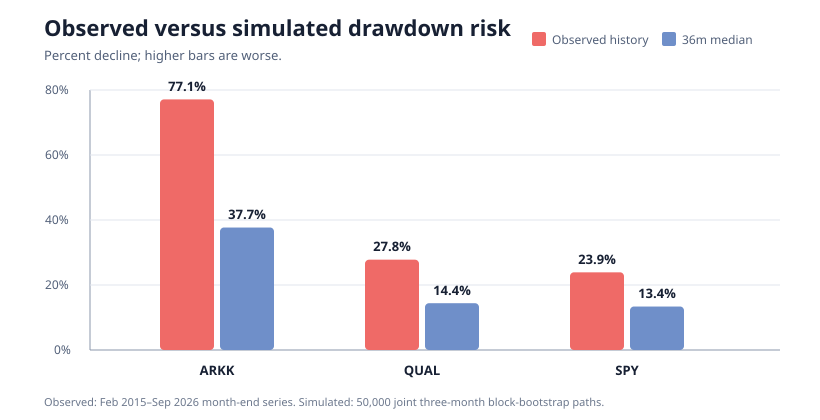

# Monte Carlo Investment Lab

A reproducible investment-risk research project comparing a speculative-technology proxy (**ARKK**), a quality-equity proxy (**QUAL**), and the S&P 500 benchmark (**SPY**).

**Live project:** https://uafadelaja-creator.github.io/monte-carlo-investment-lab/

## Current research release: v0.5 · 18 October 2026

The repository now keeps three layers deliberately separate:

1. **Illustrative assumptions:** `simulate.py` uses declared Student-t return,
   volatility, and correlation assumptions. It is not historical evidence.
2. **Empirical ETF-proxy risk:** `historical_analysis.py` resamples joint observed
   ARKK/QUAL/SPY monthly returns. It is still conditional on a short, biased sample.
3. **Statistical-arbitrage prototype:** `pairs_research.py` tests three predeclared
   same-industry pair hypotheses with delayed fills, modeled costs, and a holdout.
   It is not a signal service and has not established profitable alpha.

Version 0.5 adds the third layer's reproducible research harness:

- Fixed hypotheses: V/MA, KO/PEP, and XOM/CVX; no winner is selected ex post.
- A 2023-01-03 holdout start with 252-day trailing formation, monthly refits,
  Engle-Granger filtering, next-session-close modeled fills, 10 bps turnover cost,
  and 3% hypothetical annual borrow drag.
- Broad SPY plus XLF/XLP/XLE sector comparisons, cost/window sensitivity, and
  50,000-path moving-block uncertainty across 1/3/6/12/24/36 months.
- Tests for execution delay, look-ahead isolation, cost deduction, and bootstrap
  reproducibility; a GitHub Actions workflow downloads data at run time and does
  not commit vendor price files.

### First fixed holdout result

The documented protocol was run on 2,965 adjusted daily observations through
16 October 2026, with a 3 January 2023 holdout start. It produced only three
entries across all pairs: V/MA netted −0.005%, KO/PEP stayed flat, and XOM/CVX
netted −2.29%. Exposure ranged from 0% to 2.1% of sessions. The 36-month
moving-block loss probability was 45.7% for V/MA and 80.1% for XOM/CVX; KO/PEP's
0% loss frequency reflects no trades, not a successful strategy.

Cost and formation-window sensitivity changed outcomes materially. Descriptive
Fama-French alpha estimates were not statistically persuasive and are not proof
of implementable alpha. The current result is therefore **no demonstrated
statistical-arbitrage edge**. See `RUN_2026-10-18.md` and `STAT_ARB_GUIDE.md`.

## Empirical ETF-proxy release: v0.4 · 11 October 2026

Version 0.4 adds the project's first completed empirical extension:

- 140 common complete monthly adjusted-return observations, February 2015–September 2026.
- 50,000 joint moving-block-bootstrap paths at 1, 3, 6, 12, 24, and 36 months.
- Empirical return distributions, volatility, Sharpe ratios, drawdowns, correlations, skewness, kurtosis, VaR, and CVaR.
- Paired benchmark comparisons, a hypothetical one-month shock, and 1/3/6-month block-length sensitivity.
- A SHA-256 input hash and archived aggregate outputs; the saved project package
  retains its cache, while the public repository excludes vendor price tables.
- Two GitHub-ready charts, browser-readable JSON, and a standalone historical-results page.

The original Student-t parametric engine remains in `simulate.py` as a separate model-risk comparison. Historical resampling does not silently replace it.



## Historical sample

| Proxy | Role | Historical CAGR | Annualized volatility | Month-end maximum drawdown | Sharpe, assumed 0% risk-free rate |
|---|---|---:|---:|---:|---:|
| ARKK | Speculative technology | 14.55% | 36.42% | −77.08% | 0.55 |
| QUAL | Quality equities | 13.35% | 15.11% | −27.78% | 0.91 |
| SPY | S&P 500 benchmark | 14.06% | 14.93% | −23.93% | 0.96 |

Observed monthly correlations were 0.69 ARKK–QUAL, 0.72 ARKK–SPY, and 0.98 QUAL–SPY. The unusually high QUAL–SPY correlation means the quality proxy supplied little diversification in this particular sample.

The latest market snapshot recorded on 9 October 2026 was ARKK $89.62, QUAL $227.12, and SPY $778.57. The published simulation used only complete months through September 2026, avoiding a partial October return.

## Baseline historical-bootstrap outcomes

Each arm starts with $500 and receives the month-end equivalent of $100 per week. Each cell shows **median ending value [5th–95th percentile]; probability above contributed cash**.

| Horizon | Contributed | ARKK | QUAL | SPY |
|---|---:|---:|---:|---:|
| 1 month | $933 | $937 [$865–$1,026]; 54.8% | $939 [$895–$974]; 65.9% | $941 [$899–$973]; 69.5% |
| 3 months | $1,800 | $1,868 [$1,562–$2,212]; 61.3% | $1,840 [$1,701–$1,930]; 75.5% | $1,843 [$1,718–$1,924]; 77.0% |
| 6 months | $3,100 | $3,254 [$2,515–$4,103]; 62.7% | $3,229 [$2,923–$3,449]; 75.9% | $3,234 [$2,931–$3,454]; 77.2% |
| 12 months | $5,700 | $6,181 [$4,312–$8,675]; 65.4% | $6,129 [$5,322–$6,794]; 82.1% | $6,146 [$5,353–$6,815]; 83.5% |
| 24 months | $10,900 | $12,742 [$7,734–$21,000]; 69.8% | $12,496 [$10,296–$14,653]; 88.4% | $12,574 [$10,405–$14,739]; 89.6% |
| 36 months | $16,100 | $20,264 [$11,010–$38,127]; 73.2% | $19,715 [$15,591–$24,189]; 92.4% | $19,926 [$15,799–$24,409]; 93.5% |

### Thirty-six-month detail

| Proxy | Mean ending value | Mean return on contributed cash | Median TWR CAGR | Median / 95th-pctl max drawdown | P(beat SPY) |
|---|---:|---:|---:|---:|---:|
| ARKK | $21,885 | 35.9% | 14.2% | 37.7% / 66.2% | 53.2% |
| QUAL | $19,786 | 22.9% | 13.6% | 14.4% / 27.8% | 37.7% |
| SPY | $19,987 | 24.1% | 14.3% | 13.4% / 26.8% | — |

ARKK's right tail creates a higher mean, but the central conclusion is about risk rather than superiority: its 53.2% paired frequency of beating SPY is too close to chance to establish an edge, while its historical maximum drawdown and simulated downside are materially worse.

## Run the empirical model

Re-run from a local copy of the original cached input, when available:

```bash
python -m pip install -r requirements.txt
python historical_analysis.py \
  --csv data/adjusted_prices_through_2026-09.csv \
  --paths 50000 --block 3 --seed 20261011 --as-of 2026-10-11 \
  --outdir results
```

Refresh exploratory data through Yahoo Finance via yfinance. Provider revisions
can make refreshed output differ from the archived results:

```bash
python historical_analysis.py \
  --paths 50000 --block 3 --seed 20261011 \
  --cache-csv data/adjusted_prices_through_2026-09.csv \
  --outdir results
```

The original input's SHA-256 is recorded in `results/historical_metadata.json`.
Identical input, dependency versions, parameters, and seed reproduce the CSV
outputs. The public repository does not redistribute the vendor price table.

Run the parametric Student-t comparison separately:

```bash
python simulate.py --paths 50000 --seed 20261004 --outdir results
```

Run the unit tests:

```bash
python -m unittest discover -s tests -v
```

## Run the predeclared pairs protocol

Yahoo Finance through yfinance is used only as an exploratory source. Downloaded
prices are gitignored because adjusted closes are not executable quotes and
third-party redistribution permissions must be respected.

```bash
python download_prices.py --start 2015-01-01 --end 2026-10-17
python download_french_factors.py
python run_stat_arb_research.py \
  --test-start 2023-01-03 \
  --paths 50000 --block 20 --seed 20261018
```

The pair module has no contribution schedule: it models a self-financing long/short
return stream. The ETF portfolio modules separately preserve contribution accounting.

## Methodology

The historical engine resamples contiguous three-month blocks of **joint** ARKK/QUAL/SPY returns. This preserves observed same-month co-movement and short return sequences instead of treating assets or months as independent. Identical contribution dates are applied to all arms.

- Profit means ending nominal value exceeds cumulative contributions.
- Contribution-adjusted return is mean ending value divided by contributed cash minus one.
- CAGR and maximum drawdown use a deposit-free unitized return index.
- The primary block length is three months; one- and six-month variants test sequence sensitivity.
- The labeled shock applies −25% ARKK, −15% QUAL, and −18% SPY in the first simulated month.
- SPY comparisons are path-by-path using the same resampled market history.

## Outputs

- `historical_results.html`: standalone GitHub Pages-ready historical results.
- `results/historical_drawdown.svg`: lightweight public drawdown comparison.
- `results/historical_simulation_summary.csv`: every requested horizon and outcome statistic.
- `results/historical_risk_metrics.csv`: empirical risk statistics.
- `results/historical_correlations.csv`: empirical correlation matrix.
- `results/historical_block_sensitivity.csv`: 1/3/6-month block robustness.
- `results/historical_dashboard_data.json`: browser-readable integration data.
- `results/historical_metadata.json`: source window, seed, hash, assumptions, and limitations.
- `results/historical_metadata.json`: includes the original input hash and source window.
- `RUN_2026-10-11.md`: latest concise research report.
- `CHANGELOG.md`: version history and methodological upgrades.
- `STAT_ARB_GUIDE.md`: frozen pair protocol, data caveats, and roadmap.
- `download_prices.py`: local-only exploratory Yahoo/yfinance data fetch with hashes.
- `download_french_factors.py`: official Kenneth French daily factor download and manifest.
- `pairs_research.py`: delayed-fill, cost-aware single-pair walk-forward engine.
- `run_stat_arb_research.py`: fixed three-pair runner and robustness tables.
- `.github/workflows/empirical-research.yml`: repeatable tests and real-data run.
- Earlier run reports remain preserved for auditability.

## Data sources

- [ARK Innovation ETF](https://www.ark-funds.com/funds/arkk)
- [iShares MSCI USA Quality Factor ETF](https://www.ishares.com/us/products/256101/)
- [State Street SPDR S&P 500 ETF Trust](https://www.ssga.com/us/en/intermediary/etfs/state-street-spdr-sp-500-etf-trust-spy)
- Historical adjusted closes: Yahoo Finance through yfinance for exploratory research.

Official fund pages define the products and provide fund-level performance context.
The archived aggregate results use the hashed October 2026 research input; public
code can refresh exploratory data but does not redistribute the vendor table.

## Limitations

This is ETF-proxy research, not a point-in-time test of individual-company cohorts. It contains survivorship, launch-date, product-design, and active-strategy bias. The 2015–2026 sample is regime-dependent. A moving-block bootstrap cannot create truly unseen regimes or guarantee that past return frequencies will recur. Correlations can change abruptly, especially in crises. Month-end data miss intramonth drawdowns, liquidity gaps, and path extremes. Vendor-adjusted prices can be revised. Taxes, spreads, fund fees, inflation, and exact weekly deposit timing are omitted.

Monte Carlo output is conditional on its input sample and assumptions. It does not establish predictive certainty or an investing edge.

## Résumé bullet

> Built and published a Python investment-risk lab using 50,000 joint moving-block-bootstrap paths and 140 months of ARKK, QUAL, and SPY adjusted returns; modeled matched contribution schedules, empirical correlations, non-normal tails, drawdowns, benchmark-beating frequencies, stress tests, and reproducible multi-horizon wealth distributions.

Current extension, accurately labeled as research in progress:

> Developing a walk-forward statistical-arbitrage research harness for predeclared same-industry pairs with one-session execution delay, explicit turnover and borrow costs, broad/sector benchmarks, sensitivity tests, leakage checks, and moving-block uncertainty analysis.

