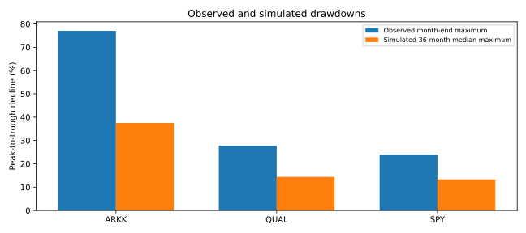

# Monte Carlo Investment Lab

A reproducible investment-risk research project comparing a speculative-technology proxy (**ARKK**), a quality-equity proxy (**QUAL**), and the S&P 500 benchmark (**SPY**).

**Live project:** https://uafadelaja-creator.github.io/monte-carlo-investment-lab/

## Historical dashboard · 7 November 2026

The public website now uses the uploaded historical dataset exclusively. The
**Historical performance** tab shows actual month-end adjusted-price performance.
The **Monte Carlo simulation** tab resamples that history into hypothetical paths.
No old hand-set return/volatility assumptions feed either page.

Both pages share navigation, typography, colors, and responsive layouts. The
Research & data page explains the model, data provenance, fund definitions,
correlations, and sampling sensitivity. The overview supports all six horizons,
$0/$50/$100/$200 weekly contribution equivalents, and baseline or hypothetical
initial-shock scenarios, with downloadable comparisons.

Run `historical_analysis.py` using the command below, then
`python render_historical_results.py` to regenerate both pages. Shared assets
live in `assets/`. All displayed metrics, normalized historical chart series,
and simulated percentile curves come from `results/historical_dashboard_data.json`.


## Current research release: v0.8 · 8 November 2026

The repository now keeps three layers deliberately separate:

1. **Illustrative assumptions:** `simulate.py` uses declared Student-t return,
   volatility, and correlation assumptions. It is not historical evidence.
2. **Empirical ETF-proxy risk:** `historical_analysis.py` resamples joint observed
   ARKK/QUAL/SPY monthly returns. It is still conditional on a short, biased sample.
3. **Statistical-arbitrage prototype:** `pairs_research.py` tests three predeclared
   same-industry pair hypotheses with delayed fills, modeled costs, and a holdout.
   It is not a signal service and has not established profitable alpha.

Version 0.8 preserves the third layer's frozen protocol, continues sequential
monitoring and the prospective audit, and reports finite-path Monte Carlo uncertainty:

- Fixed hypotheses: V/MA, KO/PEP, and XOM/CVX; no winner is selected ex post.
- A 2023-01-03 holdout start with 252-day trailing formation, monthly refits,
  Engle-Granger filtering, next-session-close modeled fills, 10 bps turnover cost,
  and 3% hypothetical annual borrow drag.
- Broad SPY plus XLF/XLP/XLE sector comparisons, cost/window sensitivity, and
  50,000-path moving-block uncertainty across 1/3/6/12/24/36 months.
- Wilson 95% intervals for finite Monte Carlo sampling error, explicitly separated
  from the much larger model, sample, vendor, and regime uncertainties.
- Tests for execution delay, look-ahead isolation, cost deduction, and bootstrap
  reproducibility; a GitHub Actions workflow downloads data at run time and does
  not commit vendor price files.
- An append-only aggregate monitoring ledger, frozen-protocol fingerprint, and
  prior-prefix price-hash check so repeated weekly runs cannot be mistaken for
  independent tests or silently absorb upstream vendor revisions.
- Exact CI dependency pins, bounded retries for the official factor download,
  and data-download defaults that exclude the current in-progress session.
- A chained-SHA forward l### Current fixed holdout result

The frozen protocol was refreshed on 2,980 adjusted daily observations through
6 November 2026, with a 3 January 2023 holdout start. It still produced only three
entries across all pairs: V/MA netted −0.005%, KO/PEP stayed flat, and XOM/CVX
netted −2.29%. Exposure ranged from 0% to 2.1% of sessions.

Across 50,000 moving-block paths, the 36-month loss frequency was 45.27% for
V/MA (finite-path 95% interval 44.83%–45.71%) and 79.81% for XOM/CVX
(79.45%–80.16%). KO/PEP's 0% frequency reflects no trades, not a successful
strategy. These intervals quantify Monte Carlo sampling error only.

The five new sessions generated no entry. All three pairs remained flat in the
prospective audit, leaving no pending next-session execution audit. The adjusted-
price prefix hash changed, so small result drift combines new sessions with upstream
vendor revision risk.

Cost and formation-window sensitivity changed outcomes materially. Descriptive
Fama-French alpha estimates were not statistically persuasive and are not proof
of implementable alpha. The current result is therefore **no demonstrated
statistical-arbitrage edge**. See `RUN_2026-11-08.md`,
`results/stat_arb_current/FORWARD_SIGNAL_AUDIT.md`, and `STAT_ARB_GUIDE.md`.

. The current result is therefore **no demonstrated
statistical-arbitrage edge**. See `RUN_2026-11-01.md`,
`results/stat_arb_current/FORWARD_SIGNAL_AUDIT.md`, and `STAT_ARB_GUIDE.md`.

## Historical data refresh · 7 November 2026

[Open the historical results dashboard](historical_results.html).

The user-supplied Yahoo Finance/yfinance CSV contains **2,980 adjusted daily price
observations from 2 January 2015 through 6 November 2026**. The historical engine
uses the last observation of each completed month: **141 monthly returns from
February 2015 through October 2026**. Partial November is excluded.

This refresh runs **50,000 joint moving-block-bootstrap paths**, with a three-month
primary block, one- and six-month sensitivity, and seed `20261011`. Each ETF is a
separate arm starting with $500 and receiving $100/week represented as $433.33 at
month-end. These conditional simulations are not out-of-sample trading evidence.
The original illustrative engine remains archived in `simulate.py`; it no longer powers the website.

### What the ETFs represent

| ETF | Strategy | Comparison role |
|---|---|---|
| [ARKK](https://www.ark-funds.com/funds/arkk) | Actively managed disruptive innovation | Innovation-focused equity risk |
| [QUAL](https://www.ishares.com/us/products/256101/QUAL) | U.S. stocks with high return on equity, stable earnings, and low debt | Quality-factor equities |
| [SPY](https://www.ssga.com/us/en/individual/etfs/state-street-spdr-sp-500-etf-trust-spy) | S&P 500 large U.S. companies | Benchmark |

These funds are not selected using Shariah screening. Do not label this comparison
a Shariah-compliant portfolio. Quality does not mean risk-free.

### Historical sample

| ETF | Historical CAGR | Annualized volatility | Month-end maximum drawdown |
|---|---:|---:|---:|
| ARKK | 13.48% | 36.43% | -77.08% |
| QUAL | 13.26% | 15.06% | -27.78% |
| SPY | 13.87% | 14.89% | -23.93% |



### Thirty-six-month baseline outcomes

$16,100 total contributed to each arm. Frequencies are conditional on the historical sample.

| ETF | Median ending value | 5th–95th percentile | P(loss) | P(beat SPY) |
|---|---:|---:|---:|---:|
| ARKK | $20,335 | $11,072–$38,201 | 26.8% | 53.9% |
| QUAL | $19,688 | $15,558–$24,180 | 7.7% | 37.9% |
| SPY | $19,906 | $15,765–$24,368 | 6.6% | — |

All six horizons, the hypothetical shock, and block-length sensitivity are in
`results/historical_dashboard_data.json` and the linked results page. Higher
simulated returns do not establish a durable investment edge.

### Reproduce with your downloaded CSV

Place your original `historical_prices.csv` inside the local `data/` directory.
The file is gitignored; vendor price tables are not redistributed publicly.

```bash
python -m pip install -r requirements.txt
python historical_analysis.py \
  --csv data/historical_prices.csv \
  --source-label "User-provided Yahoo Finance/yfinance adjusted daily closes, downloaded 2026-11-07" \
  --paths 50000 --block 3 --seed 20261011 --as-of 2026-11-07 \
  --outdir results
python render_historical_results.py
```

The exact raw input SHA-256, row count, date range, and numerical dependency
versions are in `results/historical_metadata.json`. The original CSV and matching
dependencies are needed to reproduce the published run; future vendor downloads
can revise historical prices. The uploaded prices passed structural checks but
were not independently reconciled against another provider.

The renderer reads aggregate JSON, so updating results no longer requires manually
copying numbers into the historical page. Daily prices become month-end observations;
monthly drawdowns do not measure intramonth losses. Fund expenses are embedded in
observed ETF history; no extra expense ratio is deducted.

Optional archived parametric Student-t comparison (not used by the website):

```bash
python simulate.py --paths 50000 --seed 20261004 --outdir results
```

Run the unit tests:

```bash
python -m unittest discover -s tests -v
```

## Run the predeclared pairs protocol

Yahoo Finance through yfinance is used only as an exploratory source. Downloaded
prices are gitignored because adjusted closes are not executable quotes and
third-party redistribution permissions must be respected.

```bash
python download_prices.py --start 2015-01-01
python download_french_factors.py --retries 3
python run_stat_arb_research.py \
  --test-start 2023-01-03 \
  --paths 50000 --block 20 --seed 20261018
```

The pair module has no contribution schedule: it models a self-financing long/short
return stream. The ETF portfolio modules separately preserve contribution accounting.
Use `monitor_stat_arb.py` to append a dated aggregate snapshot without changing the
frozen model. Repeated snapshots are dependent monitoring observations, not new
independent hypothesis tests.

Initialize or extend the separate forward paper-signal audit only after the final
completed session is available:

```bash
python forward_signal_audit.py \
  --results results/stat_arb \
  --data data \
  --ledger results/stat_arb/forward_signal_ledger.csv \
  --report results/stat_arb/FORWARD_SIGNAL_AUDIT.md
```

The audit does not backfill old signals. It freezes the latest observed state and
uses a chained SHA-256 ledger so prior records cannot be changed silently. A newly
observed entry is resolved only on a later run, after its next completed session
exists. Raw close and daily range/volume fields are audit context—not evidence of
an executable fill, bid/ask spread, or available borrow.

## Methodology

The historical engine resamples contiguous three-month blocks of **joint** ARKK/QUAL/SPY returns. This preserves observed same-month co-movement and short return sequences instead of treating assets or months as independent. Identical contribution dates are applied to all arms.

- Profit means ending nominal value exceeds cumulative contributions.
- Contribution-adjusted return is mean ending value divided by contributed cash minus one.
- CAGR and maximum drawdown use a deposit-free unitized return index.
- The primary block length is three months; one- and six-month variants test sequence sensitivity.
- The labeled shock applies −25% ARKK, −15% QUAL, and −18% SPY in the first simulated month.
- SPY comparisons are path-by-path using the same resampled market history.

## Outputs

- `index.html`: historical-performance and historical-bootstrap interactive dashboard.
- `historical_results.html`: matching methodology, data provenance, and sensitivity page.
- `results/historical_drawdown.svg`: lightweight public drawdown comparison.
- `results/historical_simulation_summary.csv`: every requested horizon and outcome statistic.
- `results/historical_risk_metrics.csv`: empirical risk statistics.
- `results/historical_correlations.csv`: empirical correlation matrix.
- `results/historical_block_sensitivity.csv`: 1/3/6-month block robustness.
- `results/historical_dashboard_data.json`: browser-readable integration data.
- `results/historical_metadata.json`: source window, seed, hash, assumptions, and limitations.
- `results/historical_metadata.json`: includes the original input hash and source window.
- `RUN_2026-10-11.md`: archived initial historical research report.
- `RUN_2026-11-08.md`: latest frozen stat-arb refresh and validation report.
- `render_historical_results.py`: regenerate both pages from aggregate JSON and shared layout.
- `CHANGELOG.md`: version history and methodological upgrades.
- `STAT_ARB_GUIDE.md`: frozen pair protocol, data caveats, and roadmap.
- `download_prices.py`: local-only exploratory Yahoo/yfinance data fetch with hashes.
- `download_french_factors.py`: official Kenneth French daily factor download and manifest.
- `pairs_research.py`: delayed-fill, cost-aware single-pair walk-forward engine.
- `run_stat_arb_research.py`: fixed three-pair runner and robustness tables.
- `monitor_stat_arb.py`: idempotent frozen-protocol evidence ledger and vendor-revision check.
- `forward_signal_audit.py`: append-only, hash-chained prospective state and execution audit.
- `results/stat_arb_current/monitoring_ledger.csv`: dated aggregate evidence snapshots.
- `results/stat_arb_current/forward_signal_ledger.csv`: forward observations from 1 November 2026 onward.
- `.github/workflows/empirical-research.yml`: repeatable tests and real-data run.
- Earlier run reports remain preserved for auditability.

## Data sources

- [ARK Innovation ETF](https://www.ark-funds.com/funds/arkk)
- [iShares MSCI USA Quality Factor ETF](https://www.ishares.com/us/products/256101/)
- [State Street SPDR S&P 500 ETF Trust](https://www.ssga.com/us/en/intermediary/etfs/state-street-spdr-sp-500-etf-trust-spy)
- Historical adjusted closes: Yahoo Finance through yfinance for exploratory research.

Official fund pages define the products and provide fund-level performance context.
The archived aggregate results use the hashed October 2026 research input; public
code can refresh exploratory data but does not redistribute the vendor table.

## Limitations

This is ETF-proxy research, not a point-in-time test of individual-company cohorts. It contains survivorship, launch-date, product-design, and active-strategy bias. The 2015–2026 sample is regime-dependent. A moving-block bootstrap cannot create truly unseen regimes or guarantee that past return frequencies will recur. Correlations can change abruptly, especially in crises. Month-end data miss intramonth drawdowns, liquidity gaps, and path extremes. Vendor-adjusted prices can be revised. Taxes, spreads, fund fees, inflation, and exact weekly deposit timing are omitted.

Monte Carlo output is conditional on its input sample and assumptions. It does not establish predictive certainty or an investing edge.

## Résumé bullet

> Built and published a Python investment-risk lab using 50,000 joint moving-block-bootstrap paths and 140 months of ARKK, QUAL, and SPY adjusted returns; modeled matched contribution schedules, empirical correlations, non-normal tails, drawdowns, benchmark-beating frequencies, stress tests, and reproducible multi-horizon wealth distributions.

Current empirical extension:

> Built a reproducible walk-forward statistical-arbitrage research harness for predeclared same-industry pairs with delayed execution, explicit costs, leakage tests, 50,000-path block resampling, sequential evidence monitoring, and a tamper-evident forward audit; the fixed holdout correctly reports no robust alpha.

